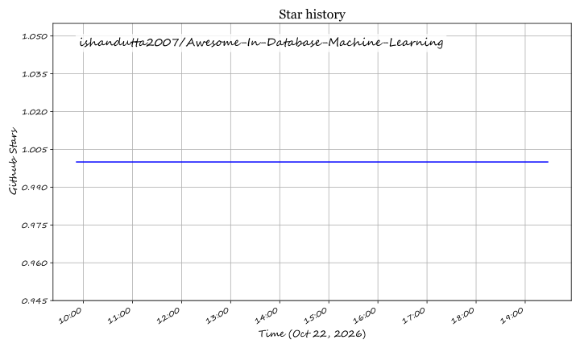

# <div align="center">Awesome In-Database Machine Learning 🚀</div>

<div align="center">



<br/><br/>

<a href="https://github.com/ishandutta2007/Awesome-Awesome-Awesome"></a><a href="https://discord.gg/jc4xtF58Ve"></a>
<a href="https://github.com/ishandutta2007/Awesome-In-Database-Machine-Learning/stargazers"></a>
<a href="https://github.com/ishandutta2007/Awesome-In-Database-Machine-Learning/network/members"></a>
<a href="https://github.com/ishandutta2007/Awesome-In-Database-Machine-Learning/blob/main/LICENSE"></a>
<a href="https://github.com/ishandutta2007/Awesome-In-Database-Machine-Learning/pulls"></a>
<a href="https://github.com/ishandutta2007"></a>

<br/>

**Curated Hub for SQL-Native Machine Learning, In-Database Model Inference & Embedded AI Engines ⚡**

*Train, score, fine-tune, and serve models directly inside relational, columnar, and analytical databases without ETL latency or data movement.*

</div>

---

## 📑 Table of Contents

- [💡 Overview & Architecture](#-overview--architecture)
- [📊 Sector Overview & Market Dynamics](#-sector-overview--market-dynamics)
- [☁️ SaaS / Hosted Cloud Platforms](#️-saas--hosted-cloud-platforms)
- [🔓 Open-Source GitHub Projects](#-open-source-github-projects)
- [🛠️ Patterns & Architectural Recipes](#️-patterns--architectural-recipes)
- [🤝 How to Contribute](#-how-to-contribute)
- [⭐ Star History](#-star-history)
- [💖 Support & Sponsorship](#-support--sponsorship)
- [⚠️ Disclaimer](#️-disclaimer)

---

## 💡 Overview & Architecture

**In-Database Machine Learning (In-DB ML)** executes mathematical, statistical, and neural algorithms directly within the storage engine or data warehouse tier. By utilizing database-native parallel processing (MPP) and calling ML algorithms through declarative SQL dialects (such as `CREATE MODEL` or `PREDICT`), data teams eliminate costly data extract-transform-load (ETL) pipelines, reduce operational network latency to near-zero, and preserve enterprise access control boundaries.

```
       Traditional ML Workflow                     In-Database ML Workflow
   ┌──────────┐      Network      ┌─────────┐         ┌─────────────────────────┐
   │ Database │ ───────────────>  │ External│         │    Database Engine      │
   │ (Storage)│    Data Egress    │ Server  │         │ ┌─────────┐ ┌─────────┐ │
   │          │ <───────────────  │ (Python)│         │ │ Storage │ │ Compute │ │
   └──────────┘    Predictions    └─────────┘         │ │ Tables  │ │  & ML   │ │
              ❌ High Latency & Risk                  │ └─────────┘ └─────────┘ │
                                                      │  ⚡ Zero Data Movement  │
                                                      └─────────────────────────┘
```

---

## 📊 Sector Overview & Market Dynamics

The global in-database analytics and Data Science & Machine Learning (DSML) platform market is estimated at approximately **$170B – $220B** (projected to exceed $750B+ into the 2030s at an ~18–30% CAGR). The sector is **moderately concentrated to oligopolistic**—dominated at the infrastructure layer by hyperscalers (Alphabet, Microsoft, Amazon) and dedicated data giants (Databricks, Snowflake), while remaining dynamic and fragmented at the specialized engine, vector search, and open-source extension tiers.

---

## ☁️ SaaS / Hosted Cloud Platforms

| Platform | Provider / Company | Company Size (Valuation / Market Cap) | Key In-Database ML Capabilities | Specific Starting Price | Free Tier / Trial Limits |
| :--- | :--- | :--- | :--- | :--- | :--- |
| **[BigQuery ML](https://cloud.google.com/bigquery/docs/model-overview)** | Google (Alphabet) | ~$4.15 Trillion (Market Cap) | Train and deploy ML models directly in BigQuery with SQL (`CREATE MODEL`). Supports linear/logistic regression, k-means, XGBoost, AutoML, and TensorFlow inference. | $6.25 per TB (on-demand query data scanned beyond free allowance); ML model training compute billed at $250.00 per TB for AutoML or equivalent slot compute | 10 GB active storage and 1 TB of query data processed per month (Free Forever) |
| **[Azure Synapse Analytics ML](https://learn.microsoft.com/en-us/azure/synapse-analytics/sql-data-warehouse/sql-data-warehouse-predict)** | Microsoft | ~$3.95 Trillion (Market Cap) | Native scoring of pre-trained ONNX models directly inside dedicated SQL pools via T-SQL `PREDICT` (models loaded via `COPY INTO`). | $1.51 per hour for Dedicated SQL Pool (DW100c base tier) + $23 per TB/month storage | 30-day free trial with $200 Azure credits (No permanent free tier for dedicated SQL pools) |
| **[Amazon Redshift ML](https://docs.aws.amazon.com/redshift/latest/dg/r_CREATE_MODEL.html)** | Amazon (AWS) | ~$2.83 Trillion (Market Cap) | Create, train, and tune ML models in Redshift via SQL powered under the hood by SageMaker Autopilot (`AUTO ON`/`OFF`). | $0.25 per hour (Provisioned `dc2.large` node on-demand) or $0.375 per RPU-hour ($1.50/hr for base 4-RPU Serverless) | 2-month free trial of 750 hours/month on `dc2.large` node (Provisioned), or 90-day trial with $300 credits (Serverless) |
| **[Oracle Autonomous Database (OML4SQL)](https://docs.oracle.com/en/database/oracle/machine-learning/oml-notebooks/)** | Oracle | ~$396 Billion (Market Cap) | Native in-database algorithms (clustering, regression, text mining, time-series) executed via SQL and PL/SQL with automated text feature extraction. | $0.336 per ECPU-hour (Serverless Transaction Processing/Lakehouse, license included) or $0.0807 per ECPU-hour (BYOL) | 2 Autonomous Database instances with 20 GB storage each & up to 30 sessions (Always Free Forever) |
| **[Databricks Lakehouse ML](https://docs.databricks.com/aws/en/reference/api)** | Databricks | ~$190 Billion (Private Valuation) | Unified lakehouse platform embedding Spark MLlib, native AutoML, MLflow tracking, and serverless model endpoints on lakehouse data. | $0.07 per DBU (AI & Model Training/Serving entry rate) or $0.15 per DBU (Jobs Compute) + cloud VM infrastructure | 14-day free trial with $400 DBU platform credits; Databricks Free Edition provides forever-free serverless compute with daily quotas |
| **[Snowflake Cortex](https://docs.snowflake.com/en/user-guide/snowflake-cortex/aisql)** | Snowflake | ~$111 Billion (Market Cap) | SQL-native ML functions and Cortex AI LLM functions (`AI_COMPLETE`, `AI_CLASSIFY`, `EMBED_TEXT`) with strict RBAC access controls. | $2.00 per Snowflake Credit (Standard Edition on-demand); $3.00 per credit (Enterprise Edition) | 30-day free trial with $400 usage credits across compute and storage (No permanent free tier) |
| **[CockroachDB](https://www.cockroachlabs.com/docs/v26.2/cockroachdb-and-ai)** | Cockroach Labs | ~$5 Billion (Private Valuation) | Distributed SQL database offering native vector search, embeddings similarity, and MCP server integrations for real-time AI apps. | $0.18 per hour (Standard provisioned cluster) or pay-as-you-go request units on Serverless | 50 million Request Units (RUs) and 10 GiB storage per month (Free Forever) |
| **[Teradata Vantage Analytics](https://www.teradata.com/)** | Teradata | ~$2.82 Billion (Market Cap) | Enterprise in-database predictive ML functions (`TD_DecisionForest`, clustering, GLM) storing trained model artifacts as JSON in the database. | $0.22 per minute elastic compute (~$4,800/month baseline cloud tier commitment) + $23 per TB/month storage | 30-day free trial sandbox with interactive pre-loaded environments (No permanent free tier) |
| **[ClickHouse Cloud](https://clickhouse.com/docs/en/sql-reference/functions/regular-functions/machine-learning-functions)** | ClickHouse Inc. | ~$2 Billion (Private Valuation) | Fast analytical engine with native SQL ML aggregate functions (`stochasticLinearRegression`, `naiveBayesClassifier`, `evalMLMethod`). | ~$0.22 to $0.75 per compute unit-hour (scale-to-zero when idle, dev configurations start at ~$66/month) + $25/TB-month storage | 30-day free trial with $300 usage credits (scale-to-zero compute supported) |
| **[SingleStore Helios](https://docs.singlestore.com/)** | SingleStore | ~$1.3 Billion (Private Valuation) | Real-time distributed SQL database with built-in AI functions (`AI_CLASSIFY`, `AI_EXTRACT`, `EMBED_TEXT`) and vector index execution. | $0.99 per hour (Standard S-00 entry workspace, 2 vCPU / 16 GB RAM) + $0.023 per average GB/month storage | 1 GB compressed storage (~4 GB raw data) with standard SQL and vector search features (Free Forever Shared Tier) |

---

## 🔓 Open-Source GitHub Projects

Curated open-source projects providing self-hosted in-database model training, embedded vector retrieval, neural extensions, and AI query engines. Sorted by GitHub stargazer count (descending).

- **[ClickHouse](https://github.com/ClickHouse/ClickHouse)** [](https://github.com/ClickHouse/ClickHouse/stargazers)  
  *High-performance open-source columnar database with built-in machine learning aggregate functions.* Enables fast linear and logistic regression (`stochasticLinearRegression`, `stochasticLogisticRegression`), Naive Bayes classification, and direct inference evaluation via `evalMLMethod` across billions of records directly in SQL.

- **[DuckDB](https://github.com/duckdb/duckdb)** [](https://github.com/duckdb/duckdb/stargazers)  
  *Embeddable analytical SQL database system designed for zero-copy in-process data analytics.* Frequently referred to as the "SQLite for Analytics", DuckDB allows direct zero-copy interchange with Python (Arrow, NumPy, Polars, PyTorch) and executes vector searches and statistical modeling inside the client process with zero network overhead.

- **[MindsDB](https://github.com/mindsdb/mindsdb)** [](https://github.com/mindsdb/mindsdb/stargazers)  
  *Open-source AI query engine and MCP server platform.* Connects disparate databases, data warehouses, and vector stores to train, fine-tune, and deploy predictive and generative ML models through standard SQL statements (`CREATE MODEL ... PREDICT ...`).

- **[pgvector](https://github.com/pgvector/pgvector)** [](https://github.com/pgvector/pgvector/stargazers)  
  *Open-source vector similarity search extension for PostgreSQL.* Enables in-database nearest-neighbor vector search (supporting HNSW and IVFFlat indexing, L2 distance, inner product, and cosine distance) directly alongside relational PostgreSQL queries.

- **[ParadeDB](https://github.com/paradedb/paradedb)** [](https://github.com/paradedb/paradedb/stargazers)  
  *Modern open-source search and analytics engine built on PostgreSQL.* Combines BM25 full-text search (`pg_search`) and high-performance vector retrieval (`pg_vector`) inside a single Postgres instance to power hybrid search and RAG workloads without needing a separate Elasticsearch or OpenSearch cluster.

- **[PostgresML](https://github.com/postgresml/postgresml)** [](https://github.com/postgresml/postgresml/stargazers)  
  *End-to-end machine learning platform implemented as a PostgreSQL extension.* Enables training traditional tabular models (XGBoost, LightGBM, Scikit-learn) and running GPU-accelerated Hugging Face transformers, embeddings generation, and LLMs directly within SQL queries inside Postgres.

- **[SQLFlow](https://github.com/sql-machine-learning/sqlflow)** [](https://github.com/sql-machine-learning/sqlflow/stargazers)  
  *Compiler and bridge connecting SQL engines to ML toolkits.* Extends traditional SQL syntax to support model training, hyperparameter tuning, and prediction using TensorFlow, PyTorch, and XGBoost on top of engines like MySQL, Hive, and MaxCompute.

- **[Alink](https://github.com/alibaba/Alink)** [](https://github.com/alibaba/Alink/stargazers)  
  *Comprehensive Machine Learning algorithm library based on Apache Flink, developed by Alibaba Computing Platform.* Offers a broad collection of distributed batch and stream ML algorithms for regression, clustering, classification, recommendation, and text analytics that execute directly across streaming databases and lakehouse pipelines.

- **[pgvectorscale](https://github.com/timescale/pgvectorscale)** [](https://github.com/timescale/pgvectorscale/stargazers)  
  *High-performance vector search extension for PostgreSQL built by Timescale.* Implements DiskANN-inspired indexing algorithms and Statistical Binary Quantization (SBQ) inside Postgres to deliver ultra-fast vector retrieval at massive scale with reduced memory footprints.

- **[EvaDB](https://github.com/georgia-tech-db/evadb)** [](https://github.com/georgia-tech-db/evadb/stargazers)  
  *Database system for building AI-powered apps over unstructured data (video, audio, text).* Developed at Georgia Tech, EvaDB incorporates deep learning models directly into query optimization plans and executes ML inference pipelines natively with a declarative SQL interface.

- **[Apache MADlib](https://github.com/apache/madlib)** [](https://github.com/apache/madlib/stargazers)  
  *The mature, enterprise-grade in-database machine learning standard for PostgreSQL and Greenplum.* An Apache Top-Level Project offering data-parallel implementations of statistical analysis, mathematical modeling, clustering, regression, decision trees, and deep neural network training that run on MPP architectures without moving data outside the cluster.

---

## 🛠️ Patterns & Architectural Recipes

- **PL/Python + Scikit-Learn / PyTorch**: Use PostgreSQL's trusted or untrusted language extensions (`plpython3u`) to create user-defined functions (UDFs) that serialize and execute Scikit-learn or ONNX models within SQL query plans.
- **ONNX Runtime in DB**: Load pre-compiled `.onnx` model graphs as binary blobs into database tables and evaluate rows in micro-batches via native UDFs for low-latency scoring.
- **Embedded Hybrid Search (BM25 + Dense Vectors)**: Co-locate vector embeddings (via `pgvector` or `pgvectorscale`) and lexical indexes (`pg_search`) in Postgres to evaluate relevance scoring without running multiple database systems.

---

## 🤝 How to Contribute

Contributions are warmly welcomed! 🌟 To suggest or add entries:

1. **Fork** this repository.
2. Create a feature branch (`git checkout -b feature/add-in-db-tool`).
3. Add the project to either SaaS or Open-Source table/list (keep Stars_Badges and formatting consistent).
4. Commit your changes (`git commit -m 'feat: add new in-database ML tool'`).
5. Push to the branch (`git push origin feature/add-in-db-tool`).
6. Open a **Pull Request** with a brief summary of the added platform.

---

## ⭐ Star History

[](https://star-history.dera.page/#ishandutta2007/Awesome-In-Database-Machine-Learning&type=date&legend=top-left)

---

## 💖 Support & Sponsorship

Thank you so much for exploring and supporting the **Awesome In-Database Machine Learning** ecosystem! 🙏

If this resource saved you engineering hours, helped you design a zero-ETL data architecture, or introduced you to new database AI tools, please consider supporting the project:

- ⭐ **Star the repository** to boost visibility for the data engineering and ML community.
- 🍴 **Fork and share** with colleagues, teammates, and communities on Reddit, LinkedIn, and X/Twitter.
- ☕ **Sponsor / Buy a coffee**: Support ongoing curation, open-source benchmarking, and maintenance via the [GitHub Sponsor Dashboard](https://github.com/sponsors/ishandutta2007).

[](https://github.com/sponsors/ishandutta2007)

---

## ⚠️ Disclaimer

- This is an independent, **community-curated** list for informational, educational, and architectural benchmarking purposes.
- **"In-database" definitions vary across technologies**: Platforms like BigQuery ML and Apache MADlib execute model training and optimization directly inside the core database engine; solutions like Azure Synapse ML score pre-trained ONNX models, while MindsDB provides a federated query and MCP server layer.
- **Pricing & Quotas**: SaaS cloud consumption prices and free tier quotas are verified as of October 2026. Verify current regional prices with respective cloud service providers before production provisioning.

---

<div align="center">
  <b>Empowering data engineers and ML practitioners to build AI where data lives. 💡</b>
</div>

## ⭐ Star History

<a href="https://star-history.com/#ishandutta2007/Awesome-In-Database-Machine-Learning&Timeline" align="center">
  <picture>
    <source media="(prefers-color-scheme: dark)" srcset="assets/ishandutta2007_Awesome-In-Database-Machine-Learning_growth.svg">
    
  </picture>
</a>
